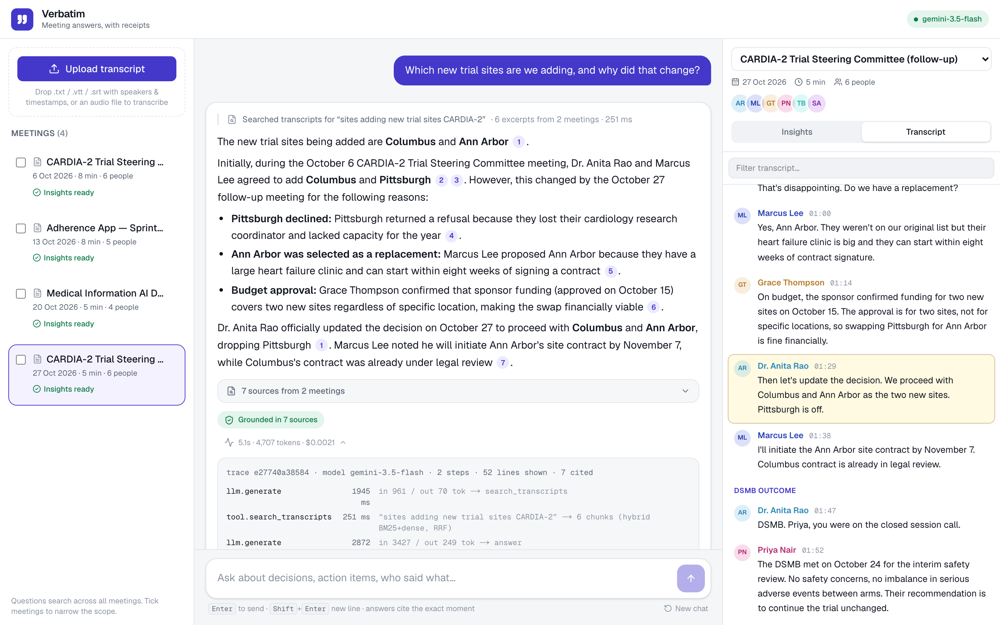
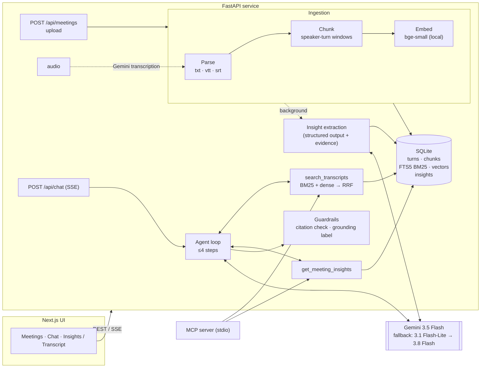
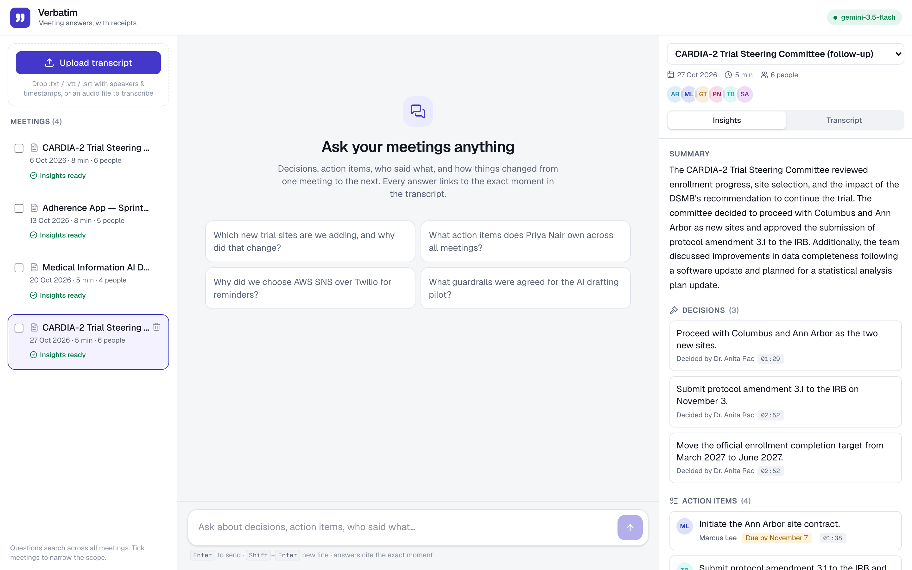
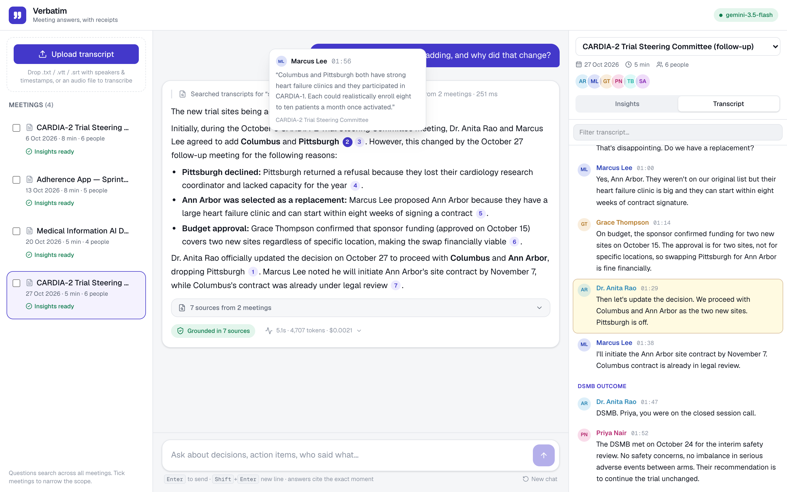
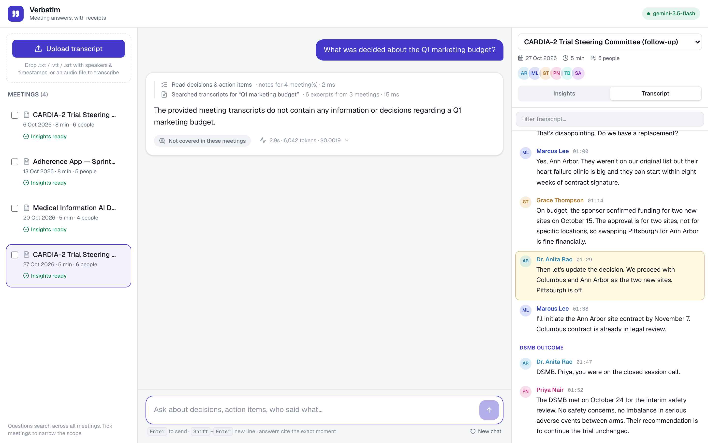
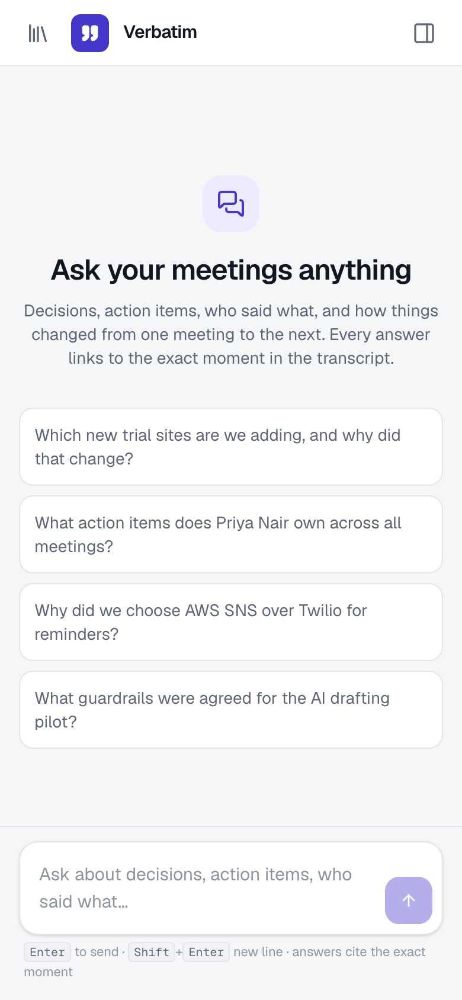

# Verbatim — meeting answers, with receipts

Ask questions about your meetings: decisions, action items, who said what, and how things changed
from one meeting to the next. Every answer is cited to the exact line and second it came from, and
clicking a citation opens the transcript at that moment.

Built for the Newpage Solutions FDE assignment (option 3: **Meeting Intelligence System**), including
the optional voice-to-transcript bonus.



- **Ask across meetings.** "Which new trial sites are we adding?" correctly reports the *latest*
  decision (Columbus + Ann Arbor), and notes Pittsburgh dropped out after the first meeting.
- **Receipts.** Numbered citations show speaker, timestamp and quote on hover; the answer is labelled
  *grounded*, *not covered* or *unverified* based on a post-generation citation check.
- **Insights per meeting.** Decisions, action items (owner, due date) and open questions are extracted
  on upload, each linked to the transcript line that supports it.
- **See the agent work.** Tool calls, timings, tokens and cost for every answer.
- **Inputs.** `.txt` (several common layouts), WebVTT (Zoom/Teams exports), SRT, or an audio file
  (transcribed with speaker labels and timestamps by Gemini).
- **Also an MCP server.** The same tools are exposed over MCP, so Claude Code / Claude Desktop can
  query the meetings directly.

Demo video: _link added on submission_ · More screenshots: [below](#screenshots)

---

## Contents

1. [Quick start](#1-quick-start)
2. [Architecture](#2-architecture)
3. [RAG / LLM approach and decisions](#3-rag--llm-approach-and-decisions)
4. [Quality: tests and evals](#4-quality-tests-and-evals)
5. [Key technical decisions](#5-key-technical-decisions)
6. [Productionizing on AWS](#6-productionizing-on-aws)
7. [Engineering standards](#7-engineering-standards)
8. [How I used AI tools](#8-how-i-used-ai-tools)
9. [What I'd do with more time](#9-what-id-do-with-more-time)

---

## 1. Quick start

You need a Gemini API key (free: <https://aistudio.google.com/apikey>). Without one, upload and search
still work, but chat and insights are disabled.

```bash
git clone https://github.com/thechetan9/verbatim-meeting-intelligence.git
cd verbatim-meeting-intelligence
echo "GEMINI_API_KEY=your-key" > backend/.env
docker compose up --build
```

Open <http://localhost:3000> and click **Load sample meetings** (four synthetic meetings from a
fictional clinical-trial team), then try one of the suggested questions.

<details>
<summary>Run without Docker (for development)</summary>

Requires Python 3.12 + [uv](https://docs.astral.sh/uv/) and Node 24.

```bash
# terminal 1 — API on :8000 (first run downloads the 67 MB embedding model)

cd backend
uv sync
echo "GEMINI_API_KEY=your-key" > .env
uv run uvicorn app.main:app_factory --factory --reload --port 8000

# terminal 2 — UI on :3000

cd frontend
npm ci
npm run dev
```

API docs: <http://localhost:8000/docs>
</details>

<details>
<summary>Use it from Claude Code over MCP</summary>

```bash
cd backend && uv sync --extra mcp
claude mcp add verbatim -- uv --directory "$(pwd)" run python -m app.mcp_server
```
Then ask Claude Code e.g. "using verbatim, what did we decide about SMS reminders?". Tools:
`list_meetings`, `search_transcripts`, `get_meeting_insights` (read-only, no LLM key needed).
</details>

**Transcript formats accepted:** `[00:01:23] Name: text`, `00:01:23 Name: text`,
`Name (00:01:23): text`, two-line "Name  00:01:23 ⏎ text" (Otter style), WebVTT with `<v Name>`
tags, and SRT with `Name:` prefixes. Examples in [`sample_data/`](sample_data).

**Files to try uploading** ([`sample_data/uploads/`](sample_data/uploads)), not loaded by the button:

- `2026-11-03_wearable-safety-review.srt`: a fifth meeting in SRT format. It continues the story
  (a safety issue with the trial wearable, new action items for Priya and Sofia), so after uploading
  it, cross-meeting answers change, e.g. "What does Priya Nair own across all meetings?".
- `2026-11-05_patient-portal-launch-sync.m4a`: a 30-second, two-speaker recording for the voice
  bonus. It is transcribed with speaker names and timestamps, then indexed and analysed like any
  other meeting. Audio formats: mp3, wav, m4a, aac, ogg, flac, webm (≤ 20 MB).

---

## 2. Architecture



#### Request flow for a question

1. The UI posts the question, recent history and (optionally) the selected meetings to `/api/chat`.
2. The agent gets a system prompt with the meeting catalog (ids, titles, dates, participants) — not
   the transcripts — plus two tools.
3. The model calls tools; the server runs them (scope enforced server-side), labels every transcript
   line it returns with a key `[S#]`, and streams each step to the UI.
4. The model answers, citing keys. Tokens stream to the UI as they arrive.
5. Guardrails check every cited key against the lines actually shown, drop unknown ones, and label
   the answer. Citations (meeting, speaker, timestamp, quote) and a trace are sent last.

**Code layout** (`backend/app/`)

| package | responsibility |
|---|---|
| `domain/` | pydantic models shared by every layer; no framework imports |
| `ingestion/` | parser (formats), chunker, ingestion service, audio transcription |
| `retrieval/` | `MeetingStore` (SQLite + FTS5), embedders, `HybridRetriever` (RRF) |
| `insights/` | per-meeting structured extraction + evidence grounding |
| `chat/` | agent loop, tools, prompts, evidence registry, guardrails |
| `llm/` | provider-neutral `LLM` protocol, Gemini adapter, scripted fake for tests |
| `api/` | HTTP routes, SSE, upload validation |
| `container.py` | the one place where implementations are chosen and wired |

---

## 3. RAG / LLM approach and decisions

The full reasoning, with alternatives and numbers, is in [`docs/DECISIONS.md`](docs/DECISIONS.md).
Summary:

| concern | choice | main reason |
|---|---|---|
| Chunking | whole speaker turns, ~180 words, 1-turn overlap, contextual header | keeps question+answer together; measured best of 6 configs |
| Embeddings | `bge-small-en-v1.5`, local ONNX | transcripts aren't sent out just to be indexed; free; deterministic CI |
| Vector store | SQLite: FTS5 + vectors, exact cosine | zero infra; exact search is ms at this scale; pgvector is the prod path |
| Retrieval | BM25 + dense, Reciprocal Rank Fusion | ids/names need BM25, paraphrases need dense; hybrid MRR 0.86 vs 0.79 / 0.71 |
| LLM | Gemini 3.5 Flash, with a fallback chain (configurable) | picked by eval across 3 models; same quality as 3.8 Flash, faster; native audio input |
| Orchestration | own bounded tool loop (no framework) | one loop + two tools; owning it keeps budget, scope and citations explicit |

**Why an agent and not a fixed "retrieve then answer" chain?** Meeting questions come in three
shapes: structured ("what does Priya own?"), discursive ("why did we drop Twilio?") and evolving
across meetings ("which sites are we adding now?"). Two tools — hybrid search over what was said,
and pre-extracted decisions/action items — cover all three, and the model can search again with
better terms when the first results are thin. The loop is capped at 4 steps; the last step has tools
disabled so it always ends with an answer.

#### Prompt and context management

- The system prompt holds rules + a compact meeting catalog, so the model can resolve "the steering
  committee" or "last week's planning" to ids. Transcripts only arrive through tools, and only the
  retrieved windows (6 chunks ≈ 1.5k words) — never whole meetings.
- Tool results are fenced (`<transcript_excerpts>`) and the prompt states they are data, not
  instructions.
- Chat history is trimmed to the last 8 messages and old citation keys are stripped (they referred to
  the previous turn's evidence and would confuse the model).
- Insights are extracted once per meeting at upload, so frequent questions don't re-read transcripts.

#### Guardrails

| risk | mitigation |
|---|---|
| Hallucinated facts | answer only from tool results; refusal path when evidence is missing |
| Fake / wrong citations | keys verified against lines actually shown; unknown keys removed; answer labelled `grounded` / `no_evidence` / `unsupported` in the UI |
| Ungrounded insights | every decision/action item must cite utterance numbers; items with no valid evidence are dropped |
| Prompt injection via transcripts | transcripts fenced as data; scope and tool limits enforced in code, not the prompt; injection patterns flagged in the trace |
| Off-topic / medical advice | system prompt limits scope to the loaded meetings; reports what was said, no advice |
| Runaway agent | 4-step budget, 300-char tool queries, top-k caps |
| Bad uploads | extension allow-list, 2 MB text / 20 MB audio limits, UTF-8 check, parse validation with a clear error |

#### Observability

- Structured JSON logs with a request id on every line (`X-Request-ID` header in, out, and on the
  logs of background work).
- Per-answer trace: spans for each LLM call and tool call with latency, tokens, retrieval ranks and
  scores, estimated cost, grounding label. Logged, and shown in the UI under each answer.
- The span shape maps directly onto OpenTelemetry; exporting to an OTel collector / Langfuse is a
  config change, not a rewrite (not done here).

---

## 4. Quality: tests and evals

```bash
cd backend
uv run pytest                          # 58 tests, offline (fake LLM, hashing embedder)
uv run python -m evals.retrieval_eval  # offline, runs in CI as a gate
uv run python -m evals.answer_eval --model gemini-3.5-flash  # end-to-end, a few cents
cd ../frontend && npm test             # SSE parser, citation linking, formatting
```

**Eval set:** [`backend/evals/dataset.yaml`](backend/evals/dataset.yaml) — 28 questions written the way
a user would ask them (not copied from the transcript), tagged by type: exact (ids, names),
paraphrase, cross-meeting (answer changed later), attribution, and unanswerable (including a
prompt-injection attempt).

**Retrieval** (24 questions with a known evidence line; deterministic):

| mode | hit@1 | hit@3 | MRR |
|---|---|---|---|
| BM25 only | 0.62 | 0.96 | 0.788 |
| dense only | 0.50 | 0.92 | 0.712 |
| **hybrid (RRF)** | **0.75** | **0.96** | **0.858** |

CI fails if hybrid MRR < 0.75 or hit@3 < 0.9. With only 15 chunks, hit@6 is 1.0 for every mode, so
ranking metrics are the meaningful ones.

**End-to-end answers**: same 28 questions on three Gemini models, fallbacks disabled so each row
is one model, deterministic checks (no LLM-as-judge):

| model | correct facts | grounded | cites the right meeting | correct refusals | latency p50 / p95 | tokens / question |
|---|---|---|---|---|---|---|
| gemini-3.8-flash | 25/25 | 25/25 | 24/24 | 3/3 | 5.3 s / 7.7 s | ~5,100 |
| **gemini-3.5-flash** (default) | 25/25 | 25/25 | 24/24 | 3/3 | 3.7 s / 5.7 s | ~4,900 |
| gemini-3.1-flash-lite | 25/25 | 25/25 | 24/24 | 3/3 | 2.1 s / 2.5 s | ~4,100 |

All three are perfect on this small set, so the choice came down to latency and robustness:
3.5-flash is faster than 3.8-flash at the same quality; flash-lite is fastest, but in earlier runs it
was the only model that cited meeting ids instead of evidence keys (the guardrail caught it). With
one data point I kept 3.5-flash as default and put flash-lite first in the fallback chain. Switching
is one env var (`LLM_MODEL`). ~5k tokens per question is a fraction of a cent at flash-class prices.

The eval earned its keep: it found an empty-answer bug at the agent's step budget, a refusal
detector that missed "I can only assist with...", and its own bug of hiding errored questions
(details in [section 8](#8-how-i-used-ai-tools)). Full per-question answers: `backend/evals/results/`.

Checks: correctness = required facts present; grounded = at least one valid citation; citation
meeting = a citation points into the meeting that holds the answer; refusals = the unanswerable
questions are declined. Full per-question report: `backend/evals/results/answers.md`.

**Honest limits of the evals:** 4 synthetic meetings and 28 questions I wrote myself, so the numbers
show direction, not production quality. Keyword checks can miss correct paraphrases. The citation
check proves a cited line exists and was shown to the model, not that it supports the sentence.

---

## 5. Key technical decisions

Beyond the RAG choices above:

- **Meeting intelligence over generic chat-with-docs.** Conversations are a harder and more realistic
  retrieval problem: answers span speakers, decisions get revised, and "who/when" matters. The demo
  data is a clinical-trial team because that is the world Newpage's clients live in.
- **Citations are keys, not quotes.** The model cites `[S4]`; the server knows exactly which meeting,
  speaker and second that is, and can reject keys it never showed. That makes "click to jump to the
  moment" possible and makes citation validity checkable.
- **Insights are pre-computed and evidence-linked.** Fast and consistent for the most common
  questions, and nothing appears in the UI without a transcript line behind it.
- **Uploads return immediately.** Parsing + embedding is synchronous (searchable in < 1 s); the LLM
  extraction runs in the background and the UI polls its status.
- **Graceful degradation.** No API key → ingestion, transcript view and search still work; chat and
  insights explain why they're disabled. LLM failures become a clear error event, never a hung stream.
- **Streaming over SSE.** Users see agent steps and tokens as they happen; POST + `fetch` streaming
  because `EventSource` can't send a body.
- **Everything behind small interfaces** (`LLM`, `Embedder`, `MeetingStore`) wired in one container.
  This is what makes the fakes in tests possible and the production swaps cheap.

---

## 6. Productionizing on AWS

What I'd change, in priority order, to run this for real users with sensitive (health-adjacent)
meeting content:

#### Data and storage

- SQLite → **Aurora PostgreSQL** with **pgvector (HNSW)** + full-text search, behind the same
  `MeetingStore` interface. Row-level security by tenant/team; meetings are access-controlled, and the
  ACL is applied as a retrieval filter so the model can't see what the user can't.
- Raw transcripts and audio in **S3** (SSE-KMS, lifecycle/retention rules). Upload via pre-signed URLs.

#### Ingestion pipeline

- S3 event → **SQS** → worker (ECS task or Lambda) for parse → chunk → embed → extract insights.
  Idempotent by content hash, retries with a DLQ, status written back to the DB (the UI already polls).
- Audio: **Amazon Transcribe** (speaker diarization, medical vocabulary) for long recordings; the
  Gemini path stays for short clips.

#### Serving

- API on **ECS Fargate** behind an **ALB** (idle timeout raised for SSE), autoscaled on CPU/requests;
  the API is stateless so this is straightforward. Frontend as a static export on **S3 + CloudFront**
  (it is fully client-rendered), or on Vercel.
- **LLM via Amazon Bedrock** (Claude) or Gemini on Vertex AI, chosen for data-residency and BAA
  coverage; the provider adapter makes this a config change. Model routing: Flash-class model by
  default, a stronger model for long cross-meeting synthesis.
- Embeddings: keep bge-small in the worker image (CPU is fine), or move to a managed embedding
  model if multilingual meetings matter.

#### Security and compliance

- SSO (Cognito / Entra ID via OIDC), per-user rate limits, AWS WAF.
- Secrets in **Secrets Manager** with rotation; no keys in images or env files.
- Optional PII/PHI redaction before text reaches the LLM (Comprehend Medical or Presidio), audit log of
  every question, answer and citation, configurable retention.

#### Operations

- OpenTelemetry → CloudWatch / X-Ray, or Langfuse for LLM-specific traces. Dashboards for p95 latency,
  tokens and cost per tenant, grounding rate, refusal rate, user feedback (thumbs up/down).
- CI/CD: GitHub Actions → ECR → deploy with Terraform/CDK; the retrieval eval gates every PR and the
  answer eval runs nightly against staging, with alerts on regressions.

**Scale notes:** retrieval is milliseconds; the LLM dominates latency (seconds) and cost (fractions of
a cent per question with Flash). Caching the per-meeting insights already removes the most expensive
repeat work; next would be prompt/context caching for the system prompt and a semantic cache for
repeated questions.

---

## 7. Engineering standards

#### Followed

- Layered architecture with dependency inversion; one composition root (`container.py`).
- 12-factor config: env vars only (`app/config.py`), `.env` git-ignored, `.env.example` provided.
- Typed everywhere: mypy on the backend, strict TypeScript on the frontend; pydantic at boundaries.
- Tests: 58 backend (parser formats, chunker invariants, retrieval + RRF, FTS query sanitising,
  guardrails, agent loop with a scripted LLM, API incl. SSE and upload validation) and 8 frontend.
  No test calls a real LLM.
- Lint/format: ruff, ESLint; complexity kept low (SonarLint clean in the editor).
- CI: lint, types, tests, retrieval eval gate, frontend build, Docker build.
- Containers: multi-stage builds, non-root users, healthcheck, embedding model baked in (offline start).
- Security basics: upload limits and allow-list, FTS query sanitising (no query-syntax injection),
  CORS allow-list, no secrets logged, pinned dependency versions.
- Dependency vulnerability audits in CI (`pip-audit` and `npm audit` on production dependencies).
  This is why the frontend is on **Next.js 16.4.2 / React 19.3.1**: Next 15.x bundles a `postcss`
  version with a high-severity advisory, fixed only in 16.x. Versions are pinned to releases at least
  two weeks old (supply-chain hygiene). One moderate advisory remains in lint-only tooling
  (`minimatch` under `typescript-eslint`); the only fix is a 9-day-old new major, so I'm waiting for
  the upstream bump rather than forcing it into a dev tool that never ships.

#### Skipped (deliberately, for time)

- Authentication, authorization and rate limiting — the API is open; it's a local demo.
- DB migrations (schema is created on start-up); would use Alembic with Postgres.
- Browser end-to-end tests (Playwright) and React component tests.
- SAST (CodeQL) and automated dependency update PRs (Dependabot) — quick to add.
- OpenTelemetry export (spans are recorded and logged, not exported).
- A proper job queue for insight extraction (in-process thread pool today).

---

## 8. How I used AI tools

I built this with **Claude Code** in VS Code as the main implementer, with me acting as the person
who decides what to build, reviews it, and decides when it's done. Most of the code was generated;
the decisions, the order of work and the definition of "done" were not left to the model.

#### How the workflow ran

1. **Decide before generating.** Picked the option, the stack and the key RAG choices first (see
   `docs/DECISIONS.md`), then asked for code in small slices in dependency order: domain models →
   parser → chunker → store → retrieval → evals → LLM adapter → agent → API → UI.
2. **Every slice ships with tests**, and tests never call a real LLM (a scripted fake implements the
   same interface). This is what caught most AI mistakes (examples below).
3. **Measure, don't eyeball.** Retrieval and chunking changes were judged by the eval harness, not by
   reading a few answers. The chunk-size table in `DECISIONS.md` is from that loop.
4. **Quality gates in the loop.** ruff, mypy, pytest, ESLint, `tsc` and the editor's SonarLint
   diagnostics were fed back into the session; functions over the complexity limit got refactored.
5. **Make it repeatable.** [`CLAUDE.md`](CLAUDE.md) holds the architecture rules and conventions
   every session must follow; [`.claude/commands/`](.claude/commands) has `/check` (all quality gates)
   and `/retrieval-experiment` (change → measure → keep or revert). A new session, or a teammate's,
   starts from the same rules.

#### Mistakes the AI made that the process caught

- The parser read the Otter-style header `Dr. Lena Fischer  00:00:05` as timestamp `00:00` with the
  text `05`. Caught by printing parsed samples; fixed with a negative look-ahead and a regression test.
- The chunker's overlap could push a chunk past its size limit, and the "merge tiny tail" step ignored
  long silences. Both caught by unit tests written next to the code.
- Resetting a `ContextVar` inside a streaming generator crashed under Starlette's thread-pool
  iteration. Caught by the SSE API test.
- **SDK drift:** `google-genai` 2.x and `mcp` 2.x differ from what the model remembered (e.g. FastMCP
  is now `MCPServer`). Rule: inspect the installed API before writing an adapter.
- **Model drift:** the first default, `gemini-2.5-flash`, turned out to be retired for new projects
  (404), and the newest flash model was intermittently overloaded (503). Found by a live smoke test,
  not by unit tests; fixed with a model fallback chain.
- **The eval lied, once.** The first answer-eval run excluded errored questions from its totals, so a
  rate-limited run looked clean. Fixed: errors are counted and shown, calls are paced and retried.
- **Empty answers.** The eval caught a case where the model wanted another search on the forced
  final step and returned no text. Fixed with an "answer now" note before that step and a
  "not found" fallback, plus a regression test.
- **A correct refusal labelled "unverified".** "I can only assist with questions related to the
  meetings" didn't match the refusal detector (it knew "help", not "assist"), so the UI would have
  shown a warning on a correct answer. Broadened the patterns and added a test.
- **UI:** a screenshot run showed that clicking a citation on desktop opened the mobile drawer's
  backdrop and dimmed the page. Fixed by opening the drawer only on narrow screens.
- Dependency hygiene: the latest `lucide-react` and `vitest` had been published days earlier; pinned
  versions at least two weeks old instead.

#### Do's

- Give the assistant a written contract (CLAUDE.md) and small, testable tasks with clear interfaces.
- Keep a fake for every external dependency so the assistant can verify its own work offline.
- Paste real failures back verbatim; ask for the fix *and* a regression test.
- Use it for breadth (boilerplate, test cases, UI states, refactors), keep depth (architecture,
  trade-offs, what to measure) as a human decision.

#### Don'ts

- Don't accept "done" without the gates passing. Don't let it edit an eval or threshold to go green.
- Don't trust its memory of fast-moving SDKs or package versions; check what's installed.
- Don't let it add frameworks or services "for later".
- Don't publish its prose as your reasoning. Decisions in this repo are written to be defended in
  a review.

---

## 9. What I'd do with more time

#### Next, in order of value

1. **Sentence-level faithfulness check.** Today I verify that cited lines exist and were shown, not that
   they support the sentence. Add an NLI model or a small LLM judge per sentence, calibrated against a
   few dozen human labels, and show "partially supported" in the UI.
2. **A real eval set.** 4 synthetic meetings and 28 questions is enough to compare options, not to
   claim quality. I'd collect de-identified real meetings, have users label answers, and track
   answer quality per release.
3. **Action-item and decision tracking across meetings.** Link "Marcus: Ann Arbor contract by Nov 7"
   to the next meeting where it's discussed and show status (done / slipped / dropped). This is the
   feature users would come back for.
4. **Speaker identity.** Map "Speaker 1" from audio and nicknames ("Anita", "Dr. Rao") to one
   person; the speaker filter is substring matching today.
5. **Retrieval at scale:** a cross-encoder re-ranker, query rewriting for vague follow-ups, and LLM- or
   embedding-based topic segmentation for long meetings instead of the silence heuristic.
6. **Production basics** from section 6: auth, tenancy, Postgres/pgvector, a job queue, OTel export.
7. **Compare models on the answer eval** (Claude Sonnet vs Gemini Flash vs a small open model) for
   quality, latency and cost per question, then route by question type.

#### What I'd do differently

- Write the eval set first. I wrote it after the first version of retrieval; having it from the start
  would have made the early chunking choices measured instead of reasoned.
- Spend less time on input-format coverage and more on cross-meeting features; real teams mostly
  export VTT from Zoom/Teams anyway.

---

## Screenshots

| Insights extracted per meeting | Hover a citation |
|---|---|
|  |  |
| **Refuses when the meetings don't cover it** | **Mobile layout** |
|  |  |

### Repository map

```
backend/            FastAPI service, evals, tests, Dockerfile
frontend/           Next.js 16 app (React 19.3, Tailwind 4)
sample_data/        4 synthetic meetings (txt in 3 layouts, WebVTT) + uploads/ (SRT meeting, audio clip)
docs/DECISIONS.md   decision log with measurements
CLAUDE.md, .claude/ instructions and commands for AI coding assistants
docker-compose.yml  one-command local run
```

All people, organisations and data in `sample_data/` are fictional.
