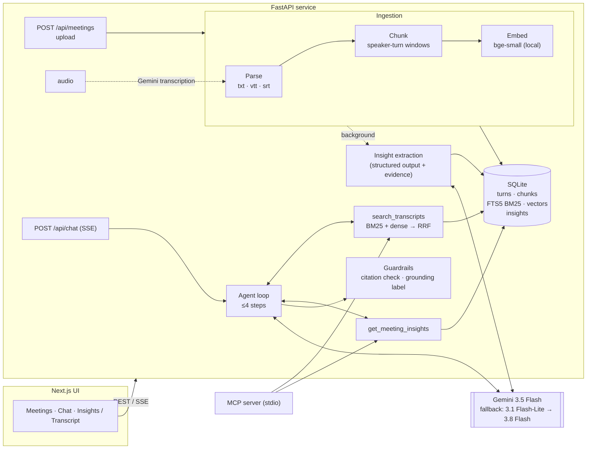
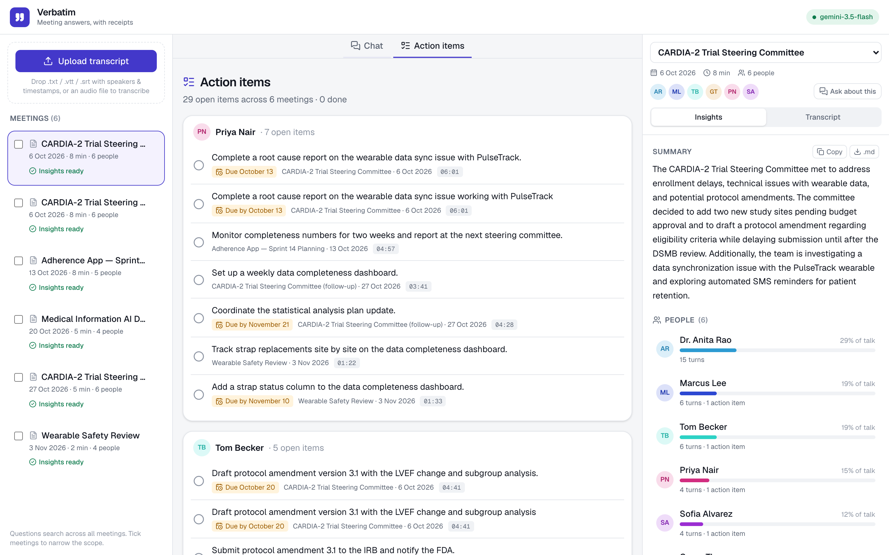
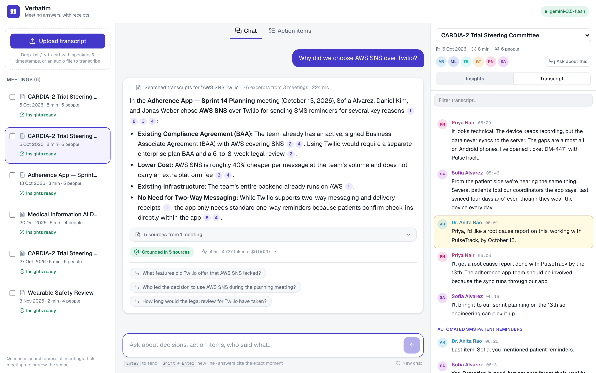
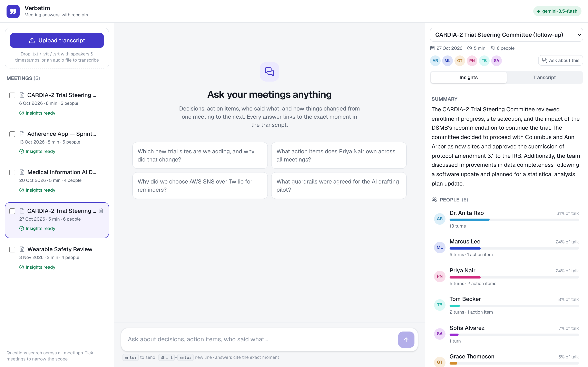
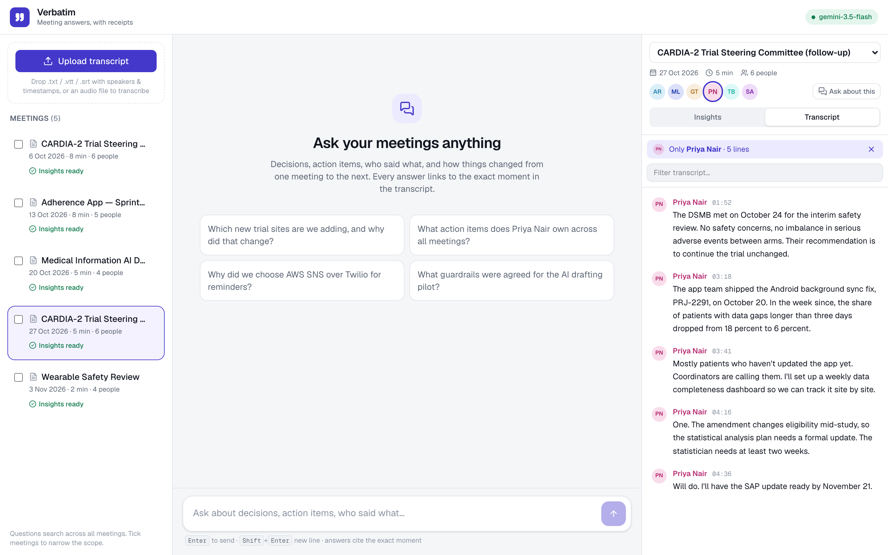

# Verbatim — Meeting Intelligence with Line-Level Citations

Ask questions about your meetings: decisions, action items, who said what, and how things changed
from one meeting to the next. Every answer is cited to the exact line and second it came from, and
clicking a citation opens the transcript at that moment.

Built for the Newpage Solutions FDE assignment (option 3: **Meeting Intelligence System**), including
the optional voice-to-transcript bonus.


- **Ask across meetings.** "Which new trial sites are we adding?" correctly reports the *latest*
  decision (Columbus + Ann Arbor), and notes Pittsburgh dropped out after the first meeting.
- **Verified citations.** Numbered citations show speaker, timestamp and quote on hover; the answer is labelled
  *grounded*, *not covered* or *unverified* based on a post-generation citation check.
- **Insights per meeting.** Decisions, action items (owner, due date) and open questions are extracted
  on upload, each linked to the transcript line that supports it.
- **Action-item tracker.** Every task from every meeting grouped by person, with due dates, a link
  to the moment it was assigned, and done/open ticks. Owners are resolved across meetings
  ("Marcus", "Marcus Lee" and "Dr. Rao" group correctly).
- **Follow-up suggestions** under each answer, and **export** of any meeting's notes as Markdown
  (copy or download) for email, Slack or a ticket.
- **People view.** Each participant's share of the talking, turns and action items; click anyone
  to read only what they said.
- **See the agent work.** Tool calls, timings, tokens and cost for every answer. Conversations
  survive a page reload (kept in the browser; meetings live in the backend database).
- **Inputs.** `.txt` (several common layouts), WebVTT (Zoom/Teams exports), SRT, or an audio file
  (transcribed with speaker labels and timestamps by Gemini).
- **Also an MCP server.** The same tools are exposed over MCP, so Claude Code / Claude Desktop can
  query the meetings directly.

Demo video: _link added on submission_ · More screenshots: [below](#screenshots)

---

## Contents

1. [Quick start](#1-quick-start)
2. [Architecture](#2-architecture)
3. [RAG / LLM approach and decisions](#3-rag--llm-approach-and-decisions)
4. [Quality: tests and evals](#4-quality-tests-and-evals)
5. [Key technical decisions](#5-key-technical-decisions)
6. [Productionizing on AWS](#6-productionizing-on-aws)
7. [Engineering standards](#7-engineering-standards)
8. [How I used AI tools](#8-how-i-used-ai-tools)
9. [What I'd do with more time](#9-what-id-do-with-more-time)

---

## 1. Quick start

You need a Gemini API key (free: <https://aistudio.google.com/apikey>). Without one, upload and search
still work, but chat and insights are disabled.

```bash
git clone https://github.com/thechetan9/verbatim-meeting-intelligence.git
cd verbatim-meeting-intelligence
echo "GEMINI_API_KEY=your-key" > backend/.env
docker compose up --build
```

Open <http://localhost:3000> and click **Load sample meetings** (four synthetic meetings from a
fictional clinical-trial team), then try one of the suggested questions.

<details>
<summary>Run without Docker (for development)</summary>

Requires Python 3.12 + [uv](https://docs.astral.sh/uv/) and Node 24.

```bash
# terminal 1 — API on :8000 (first run downloads the 67 MB embedding model)

cd backend
uv sync
echo "GEMINI_API_KEY=your-key" > .env
uv run uvicorn app.main:app_factory --factory --reload --port 8000

# terminal 2 — UI on :3000

cd frontend
npm ci
npm run dev
```

API docs: <http://localhost:8000/docs>
</details>

<details>
<summary>Use it from Claude Code over MCP</summary>

```bash
cd backend && uv sync --extra mcp
claude mcp add verbatim -- uv --directory "$(pwd)" run python -m app.mcp_server
```
Then ask Claude Code e.g. "using verbatim, what did we decide about SMS reminders?". Tools:
`list_meetings`, `search_transcripts`, `get_meeting_insights` (read-only, no LLM key needed).
</details>

**Transcript formats accepted:** `[00:01:23] Name: text`, `00:01:23 Name: text`,
`Name (00:01:23): text`, two-line "Name  00:01:23 ⏎ text" (Otter style), WebVTT with `<v Name>`
tags, and SRT with `Name:` prefixes. Examples in [`sample_data/`](sample_data).

**Files to try uploading** ([`sample_data/uploads/`](sample_data/uploads)), not loaded by the button:

- `2026-11-03_wearable-safety-review.srt`: a fifth meeting in SRT format. It continues the story
  (a safety issue with the trial wearable, new action items for Priya and Sofia), so after uploading
  it, cross-meeting answers change, e.g. "What does Priya Nair own across all meetings?".
- `remote-control-design-kickoff.m4a`: **real human speech**, a 2-minute excerpt of a four-person
  product-design kickoff from the [AMI Meeting Corpus](https://groups.inf.ed.ac.uk/ami/corpus/)
  (CC BY 4.0, see [attribution](sample_data/uploads/ATTRIBUTION.md)). Speakers are named from
  their introductions (Laura, David, Andrew, Craig). It's an introductions-and-brief segment, so the
  insights correctly show no decisions or action items yet.
- `2026-11-05_patient-portal-launch-sync.m4a`: a short, scripted two-speaker clip (synthetic voices)
  that does contain a decision and action items.

Audio is transcribed with speaker names and timestamps, then indexed and analysed like any other
meeting. Formats: mp3, wav, m4a, aac, ogg, flac, webm (≤ 20 MB).

---

## 2. Architecture



#### Request flow for a question

1. The UI posts the question, recent history and (optionally) the selected meetings to `/api/chat`.
2. The agent gets a system prompt with the meeting catalog (ids, titles, dates, participants) — not
   the transcripts — plus two tools.
3. The model calls tools; the server runs them (scope enforced server-side), labels every transcript
   line it returns with a key `[S#]`, and streams each step to the UI.
4. The model answers, citing keys. Tokens stream to the UI as they arrive.
5. Guardrails check every cited key against the lines actually shown, drop unknown ones, and label
   the answer. Citations (meeting, speaker, timestamp, quote) and a trace are sent last.

**Code layout** (`backend/app/`)

| package | responsibility |
|---|---|
| `domain/` | pydantic models shared by every layer; no framework imports |
| `ingestion/` | parser (formats), chunker, ingestion service, audio transcription |
| `retrieval/` | `MeetingStore` (SQLite + FTS5), embedders, `HybridRetriever` (RRF) |
| `insights/` | per-meeting structured extraction + evidence grounding |
| `chat/` | agent loop, tools, prompts, evidence registry, guardrails |
| `llm/` | provider-neutral `LLM` protocol, Gemini adapter, scripted fake for tests |
| `api/` | HTTP routes, SSE, upload validation |
| `container.py` | the one place where implementations are chosen and wired |

---

## 3. RAG / LLM approach and decisions

The full reasoning, with alternatives and numbers, is in [`docs/DECISIONS.md`](docs/DECISIONS.md).
Summary:

| concern | choice | main reason |
|---|---|---|
| Chunking | whole speaker turns, ~180 words, 1-turn overlap, contextual header | keeps question+answer together; measured best of 6 configs |
| Embeddings | `bge-small-en-v1.5`, local ONNX | transcripts aren't sent out just to be indexed; free; deterministic CI |
| Vector store | SQLite: FTS5 + vectors, exact cosine | zero infra; exact search is ms at this scale; pgvector is the prod path |
| Retrieval | BM25 + dense, Reciprocal Rank Fusion | ids/names need BM25, paraphrases need dense; hybrid MRR 0.86 vs 0.79 / 0.71 |
| LLM | Gemini 3.5 Flash, with a fallback chain (configurable) | picked by eval across 3 models; same quality as 3.8 Flash, faster; native audio input |
| Orchestration | own bounded tool loop (no framework) | one loop + two tools; owning it keeps budget, scope and citations explicit |

**Why an agent and not a fixed "retrieve then answer" chain?** Meeting questions come in three
shapes: structured ("what does Priya own?"), discursive ("why did we drop Twilio?") and evolving
across meetings ("which sites are we adding now?"). Two tools — hybrid search over what was said,
and pre-extracted decisions/action items — cover all three, and the model can search again with
better terms when the first results are thin. The loop is capped at 4 steps; the last step has tools
disabled so it always ends with an answer.

#### Prompt and context management

- The system prompt holds rules + a compact meeting catalog, so the model can resolve "the steering
  committee" or "last week's planning" to ids. Transcripts only arrive through tools, and only the
  retrieved windows (6 chunks ≈ 1.5k words) — never whole meetings.
- Tool results are fenced (`<transcript_excerpts>`) and the prompt states they are data, not
  instructions.
- Chat history is trimmed to the last 8 messages and old citation keys are stripped (they referred to
  the previous turn's evidence and would confuse the model).
- Insights are extracted once per meeting at upload, so frequent questions don't re-read transcripts.

#### Guardrails

| risk | mitigation |
|---|---|
| Hallucinated facts | answer only from tool results; refusal path when evidence is missing |
| Fake / wrong citations | keys verified against lines actually shown; unknown keys removed; answer labelled `grounded` / `no_evidence` / `unsupported` in the UI |
| Ungrounded insights | every decision/action item must cite utterance numbers; items with no valid evidence are dropped |
| Prompt injection via transcripts | transcripts fenced as data; scope and tool limits enforced in code, not the prompt; injection patterns flagged in the trace |
| Off-topic / medical advice | system prompt limits scope to the loaded meetings; reports what was said, no advice |
| Runaway agent | 4-step budget, 300-char tool queries, top-k caps |
| Bad uploads | extension allow-list, 2 MB text / 20 MB audio limits, UTF-8 check, parse validation with a clear error |
| Duplicate uploads | content hash per upload; a re-upload returns 409 "already uploaded as …" (for audio, before paying for transcription) |

#### Observability

- Structured JSON logs with a request id on every line (`X-Request-ID` header in, out, and on the
  logs of background work).
- Per-answer trace: spans for each LLM call and tool call with latency, tokens, retrieval ranks and
  scores, estimated cost, grounding label. Logged, and shown in the UI under each answer.
- The span shape maps directly onto OpenTelemetry; exporting to an OTel collector / Langfuse is a
  config change, not a rewrite (not done here).

---

## 4. Quality: tests and evals

```bash
cd backend
uv run pytest                          # 66 tests, offline (fake LLM, hashing embedder)
uv run python -m evals.retrieval_eval  # offline, runs in CI as a gate
uv run python -m evals.answer_eval --model gemini-3.5-flash  # end-to-end, a few cents
cd ../frontend && npm test             # 16 tests: SSE parser, citations, notes export, tracker, storage
```

**Eval set:** [`backend/evals/dataset.yaml`](backend/evals/dataset.yaml) — 28 questions written the way
a user would ask them (not copied from the transcript), tagged by type: exact (ids, names),
paraphrase, cross-meeting (answer changed later), attribution, and unanswerable (including a
prompt-injection attempt).

**Retrieval** (24 questions with a known evidence line; deterministic):

| mode | hit@1 | hit@3 | MRR |
|---|---|---|---|
| BM25 only | 0.62 | 0.96 | 0.788 |
| dense only | 0.50 | 0.92 | 0.712 |
| **hybrid (RRF)** | **0.75** | **0.96** | **0.858** |

CI fails if hybrid MRR < 0.75 or hit@3 < 0.9. With only 15 chunks, hit@6 is 1.0 for every mode, so
ranking metrics are the meaningful ones.

**End-to-end answers**: same 28 questions on three Gemini models, fallbacks disabled so each row
is one model, deterministic checks (no LLM-as-judge):

| model | correct facts | grounded | cites the right meeting | correct refusals | latency p50 / p95 | tokens / question |
|---|---|---|---|---|---|---|
| gemini-3.8-flash | 25/25 | 25/25 | 24/24 | 3/3 | 5.3 s / 7.7 s | ~5,100 |
| **gemini-3.5-flash** (default) | 25/25 | 25/25 | 24/24 | 3/3 | 3.7 s / 5.7 s | ~4,900 |
| gemini-3.1-flash-lite | 25/25 | 25/25 | 24/24 | 3/3 | 2.1 s / 2.5 s | ~4,100 |

All three are perfect on this small set, so the choice came down to latency and robustness:
3.5-flash is faster than 3.8-flash at the same quality; flash-lite is fastest, but in earlier runs it
was the only model that cited meeting ids instead of evidence keys (the guardrail caught it). With
one data point I kept 3.5-flash as default and put flash-lite first in the fallback chain. Switching
is one env var (`LLM_MODEL`). ~5k tokens per question is a fraction of a cent at flash-class prices.

Running the live eval harness caught three subtle bugs before submission: an empty response when
the agent hit its 4-step budget, a refusal regex that missed "I can only assist with...", and an
error-counting bug in the eval script itself (covered in detail in [section 8](#8-how-i-used-ai-tools)).

Checks: correctness = required facts present; grounded = at least one valid citation; citation
meeting = a citation points into the meeting that holds the answer; refusals = the unanswerable
questions are declined. Full per-question reports: `backend/evals/results/answers-<model>.md`.

**Honest limits of the evals:** 4 synthetic meetings and 28 questions I wrote myself, so the numbers
show direction, not production quality. Keyword checks can miss correct paraphrases. The citation
check proves a cited line exists and was shown to the model, not that it supports the sentence.

---

## 5. Key technical decisions

Beyond the RAG choices above:

- **Meeting intelligence over generic chat-with-docs.** Conversations are a harder and more realistic
  retrieval problem: answers span speakers, decisions get revised, and "who/when" matters. The demo
  data is a clinical-trial team because that is the world Newpage's clients live in.
- **Citations are keys, not quotes.** The model cites `[S4]`; the server knows exactly which meeting,
  speaker and second that is, and can reject keys it never showed. That makes "click to jump to the
  moment" possible and makes citation validity checkable.
- **Insights are pre-computed and evidence-linked.** Fast and consistent for the most common
  questions, and nothing appears in the UI without a transcript line behind it.
- **Uploads return immediately.** Parsing + embedding is synchronous (searchable in < 1 s); the LLM
  extraction runs in the background and the UI polls its status.
- **Graceful degradation.** No API key → ingestion, transcript view and search still work; chat and
  insights explain why they're disabled. LLM failures become a clear error event, never a hung stream.
- **Streaming over SSE.** Users see agent steps and tokens as they happen; POST + `fetch` streaming
  because `EventSource` can't send a body.
- **Everything behind small interfaces** (`LLM`, `Embedder`, `MeetingStore`) wired in one container.
  This is what makes the fakes in tests possible and the production swaps cheap.

---

## 6. Productionizing on AWS

What I'd change, in priority order, to run this for real users with sensitive (health-adjacent)
meeting content:

#### Data and storage

- SQLite → **Aurora PostgreSQL** with **pgvector (HNSW)** + full-text search, behind the same
  `MeetingStore` interface. Row-level security by tenant/team; meetings are access-controlled, and the
  ACL is applied as a retrieval filter so the model can't see what the user can't.
- Raw transcripts and audio in **S3** (SSE-KMS, lifecycle/retention rules). Upload via pre-signed URLs.

#### Ingestion pipeline

- S3 event → **SQS** → worker (ECS task or Lambda) for parse → chunk → embed → extract insights.
  Idempotent by content hash, retries with a DLQ, status written back to the DB (the UI already polls).
- Audio: **Amazon Transcribe** (speaker diarization, medical vocabulary) for long recordings; the
  Gemini path stays for short clips.

#### Serving

- API on **ECS Fargate** behind an **ALB** (idle timeout raised for SSE), autoscaled on CPU/requests;
  the API is stateless so this is straightforward. Frontend as a static export on **S3 + CloudFront**
  (it is fully client-rendered), or on Vercel.
- **LLM via Amazon Bedrock** (Claude) or Gemini on Vertex AI, chosen for data-residency and BAA
  coverage; the provider adapter makes this a config change. Model routing: Flash-class model by
  default, a stronger model for long cross-meeting synthesis.
- Embeddings: keep bge-small in the worker image (CPU is fine), or move to a managed embedding
  model if multilingual meetings matter.

#### Security and compliance

- SSO (Cognito / Entra ID via OIDC), per-user rate limits, AWS WAF.
- Secrets in **Secrets Manager** with rotation; no keys in images or env files.
- Optional PII/PHI redaction before text reaches the LLM (Comprehend Medical or Presidio), audit log of
  every question, answer and citation, configurable retention.

#### Operations

- OpenTelemetry → CloudWatch / X-Ray, or Langfuse for LLM-specific traces. Dashboards for p95 latency,
  tokens and cost per tenant, grounding rate, refusal rate, user feedback (thumbs up/down).
- CI/CD: GitHub Actions → ECR → deploy with Terraform/CDK; the retrieval eval gates every PR and the
  answer eval runs nightly against staging, with alerts on regressions.

**Scale notes:** retrieval is milliseconds; the LLM dominates latency (seconds) and cost (fractions of
a cent per question with Flash). Caching the per-meeting insights already removes the most expensive
repeat work; next would be prompt/context caching for the system prompt and a semantic cache for
repeated questions.

---

## 7. Engineering standards

#### Followed

- Layered architecture with dependency inversion; one composition root (`container.py`).
- 12-factor config: env vars only (`app/config.py`), `.env` git-ignored, `.env.example` provided.
- Typed everywhere: mypy on the backend, strict TypeScript on the frontend; pydantic at boundaries.
- Tests: 66 backend (parser formats, chunker invariants, retrieval + RRF, FTS query sanitising,
  guardrails, agent loop with a scripted LLM, tracker, follow-ups, duplicate uploads, API incl. SSE
  and upload validation) and 16 frontend.
  No test calls a real LLM.
- Lint/format: ruff, ESLint; complexity kept low (SonarLint clean in the editor).
- CI: lint, types, tests, retrieval eval gate, frontend build, Docker build.
- Containers: multi-stage builds, non-root users, healthcheck, embedding model baked in (offline start).
- Security basics: upload limits and allow-list, FTS query sanitising (no query-syntax injection),
  CORS allow-list, no secrets logged, pinned dependency versions.
- Dependency vulnerability audits in CI (`pip-audit` and `npm audit` on production dependencies).
  This is why the frontend is on **Next.js 16.4.2 / React 19.3.1**: Next 15.x bundles a `postcss`
  version with a high-severity advisory, fixed only in 16.x. Versions are pinned to releases at least
  two weeks old (supply-chain hygiene). One moderate advisory remains in lint-only tooling
  (`minimatch` under `typescript-eslint`); the only fix is a 9-day-old new major, so I'm waiting for
  the upstream bump rather than forcing it into a dev tool that never ships.

#### Skipped (deliberately, for time)

- Authentication, authorization and rate limiting — the API is open; it's a local demo.
- DB migrations (schema is created on start-up); would use Alembic with Postgres.
- Browser end-to-end tests (Playwright) and React component tests.
- SAST (CodeQL) and automated dependency update PRs (Dependabot) — quick to add.
- OpenTelemetry export (spans are recorded and logged, not exported).
- A proper job queue for insight extraction (in-process thread pool today).

---

## 8. How I used AI tools

I used **Claude Code** inside VS Code to write most of the implementation code for this project, treating it the same way I do on my own production side projects: I own the system design, interfaces, and verification gates, and I use the agent to move fast on implementation, tests, and refactors.

#### How I structured the workflow

1. **Architecture and contracts before code generation.** Before prompting for feature code, I locked down the domain problem (Option 3 with clinical-trial transcripts), the storage/retrieval design (`docs/DECISIONS.md`), and the core boundaries (`LLM`, `Embedder`, `MeetingStore`) wired through a single composition root (`container.py`). Having strict interfaces up front stops the agent from coupling FastAPI routes directly to SQLite queries or SDK payloads.
2. **Encoding rules in `CLAUDE.md` and slash commands.** If you don't give an AI coding agent persistent guardrails, every new context window drifts in style and architecture. I put the repo conventions, layer boundaries, and testing rules into [`CLAUDE.md`](CLAUDE.md), and set up repeatable workflows in [`.claude/commands/`](.claude/commands):
   - `/check` runs the full verification suite (`ruff`, `mypy`, `pytest`, offline retrieval eval, `eslint`, `tsc`, frontend tests and build).
   - `/retrieval-experiment` enforces a strict loop: change one retrieval parameter, run the eval harness, and revert if MRR or hit@1 drops.
3. **Vertical slices with offline fakes.** I had Claude Code build in dependency order: domain models → parser → chunker → SQLite/FTS5 store → hybrid retriever → eval harness → Gemini adapter → agent loop → API → Next.js UI. Because every external dependency has a deterministic fake (`FakeLLM` with scripted steps, a hashing embedder), the agent could run `pytest` after every edit without burning API tokens or hitting network flakiness.
4. **Data-driven tuning over eyeball testing.** Rather than reading two or three chat responses and guessing if chunking worked, I had the agent run 6 chunking configurations against the 24-question retrieval benchmark and log the numbers in `DECISIONS.md` before moving on to the chat layer.

#### Where the AI stumbled (and how my checks caught it)

AI coding tools are great at velocity, but they regularly fail on edge cases, concurrency subtleties, and recent SDK changes. A few concrete bugs my workflow caught during this build:

- **Regex greediness on transcript headers:** On Otter-style transcripts (`Dr. Lena Fischer  00:00:05`), the first parser regex matched `00:00` as a `MM:SS` timestamp and treated `05` as the start of the spoken text. I caught this by inspecting parsed output on sample files and had Claude add a negative look-ahead along with a regression test.
- **Chunker boundary math:** The initial chunker allowed the 1-turn overlap to push chunks over the word budget, and its tail-merging logic merged turns across long pauses. Unit tests asserting chunk size and silence invariants caught both immediately.
- **Streaming generator `ContextVar` crash:** In the SSE streaming endpoint, resetting the request-ID `ContextVar` token inside the generator failed when Starlette iterated it across thread-pool boundaries. The SSE integration test caught the crash before I even opened the browser.
- **Outdated training data on SDKs and models:** Claude Code reached for older patterns in `google-genai` 2.x and `mcp` 2.x (where `FastMCP` was replaced by `MCPServer`). It also defaulted to `gemini-2.5-flash`, which now returns `404` on new projects, while the newest model occasionally threw `503` under load. I made the agent inspect the installed package signatures directly in `.venv` before writing adapters, and added an automatic model fallback chain (`3.5-flash` → `3.1-flash-lite` → `3.8-flash`) after live smoke testing.
- **A silent pass in the eval script:** On my first live run of `answer_eval`, rate-limited requests errored and the script excluded them from the totals, making a partial run look clean. I fixed the harness so errors are counted and shown, and added pacing + retries.
- **Agent step-budget edge case:** During full eval runs, a query that had used its tool calls still wanted to search again on the final step and returned an empty answer once tools were disabled. The eval flagged it; I fixed it by adding a final-step instruction ("tool budget reached, answer from the evidence gathered so far") plus a safe fallback message.
- **Overly narrow refusal regex:** When the model answered an off-topic question with *"I can only assist with questions related to the meetings"*, the guardrail marked it `unsupported` instead of `no_evidence` because the detector only knew *"help"*/*"answer"*, not *"assist"*. Expanded the refusal patterns and added test coverage.
- **Desktop UI drawer bug & supply-chain checks:** Reviewing the UI visually showed that clicking a citation on desktop triggered the mobile drawer backdrop and dimmed the screen. I also ran `pip-audit` and `npm audit`, which prompted upgrading the frontend from Next.js 15 to 16.4.2 to clear a high-severity `postcss` advisory, while keeping package versions pinned to releases at least two weeks old.

#### My do's and don'ts with AI coding assistants

**Do's:**

- **Do front-load the design and rules.** Spend time on `CLAUDE.md`, strict types (`mypy`, TypeScript strict mode, Pydantic), and clean interfaces before letting the agent write implementation code.
- **Do give the agent fast, offline feedback loops.** When `pytest`, linters, and SonarLint diagnostics run in seconds without API keys, you can make the agent self-correct before you ever review the diff.
- **Do verify against live packages and real data.** Make the agent read installed library source/types when working with fast-moving SDKs like `mcp` or `google-genai`.
- **Do read every diff like a PR review.** Treat the assistant like a fast junior-to-mid engineer: great at scaffolding and test permutations, but prone to subtle logic shortcuts.

**Don'ts:**

- **Don't let the agent weaken a test or eval threshold to make CI pass.** If an eval or test fails, fix the implementation or explicitly discuss why the test assumption was wrong.
- **Don't let it pull in heavy frameworks "just in case".** Keeping the agent loop to ~150 lines of plain Python instead of pulling in LangChain made debugging step budgets, SSE events, and citation keys much simpler.
- **Don't trust green unit tests alone for LLM features.** Unit tests validate plumbing; you still need an eval harness and live smoke tests to catch model deprecations, rate limits, and prompt edge cases.

---

## 9. What I'd do with more time

#### What I'd build next (by impact)

1. **Claim-level faithfulness verification:** Right now, my post-generation guardrail proves that `[S4]` is a real utterance that was actually retrieved and shown to the model in that turn, which eliminates hallucinated IDs. However, it doesn't verify that the text of `[S4]` logically entails the specific claim in the sentence. With more time, I'd add a fast NLI pass or lightweight judge check per cited sentence to flag partial support.
2. **Cross-meeting state resolution for action items and decisions:** The tracker already groups action items from every meeting by person. The real product value for clinical or engineering teams is longitudinal tracking: automatically linking an action item created in one meeting ("Marcus to initiate the Ann Arbor site contract by Nov 7") to the follow-up meeting where it's reported done or delayed.
3. **Broader, nastier evaluation dataset:** My 28-question eval set over 4 synthetic meetings was enough to compare BM25 vs. dense vs. RRF and catch regressions, but synthetic data is cleaner than real life. Next, I'd test against messy, long-form transcripts (1-hour+ calls with crosstalk, interruptions, and ASR errors) and swap keyword assertions for rubric-based grading calibrated against human labels.
4. **Smarter entity & speaker resolution:** Audio diarization can output generic labels (`Speaker 1`), and text transcripts mix first names, full names, and titles (`Anita`, `Dr. Rao`). A proper entity-resolution pass at ingestion time would make speaker filtering and ownership tracking more reliable than today's name matching.
5. **Two-stage retrieval for larger workspaces:** With a handful of meetings, SQLite FTS5 + exact cosine + RRF runs in a few milliseconds. Once a team has hundreds of hours of transcripts, I'd add metadata pre-filtering (date ranges, participants), a cross-encoder re-ranker (`bge-reranker-base`) over the top 30 chunks, and topic-shift segmentation instead of relying purely on word counts and silence gaps.
6. **Production hardening:** Move storage to Postgres + `pgvector` with tenant-level RLS, push audio transcription and insight extraction onto a proper async queue (SQS/Celery) instead of an in-process thread pool, and wire the existing trace spans into an OpenTelemetry exporter (Langfuse / CloudWatch).

#### What I'd do differently if starting over

- **Build `evals/` before writing the first retriever:** I built the initial chunker and retriever first and wrote `dataset.yaml` right after. Writing the evaluation questions immediately after creating the sample transcripts would have given me a baseline score from minute one.
- **Spend less time on regexes for transcript layouts:** Supporting Otter, SRT, WebVTT, and several `.txt` timestamp styles was fun to test-drive, but most enterprise teams export WebVTT from Zoom/Teams or upload raw audio. I'd keep VTT + audio and spend that extra time on cross-meeting decision linking.

---

## Screenshots

| Insights extracted per meeting | Hover a citation |
|---|---|
|  |  |
| **Action items across all meetings, by person** | **Suggested follow-up questions** |
|  |  |
| **People: share of talk, turns, action items** | **Click a person to read only their lines** |
|  |  |
| **Refuses when the meetings don't cover it** | **Mobile layout** |
|  |  |

### Repository map

```
backend/            FastAPI service, evals, tests, Dockerfile
frontend/           Next.js 16 app (React 19.3, Tailwind 4)
sample_data/        4 synthetic meetings (txt in 3 layouts, WebVTT) + uploads/ (SRT meeting, audio clip)
docs/DECISIONS.md   decision log with measurements
CLAUDE.md, .claude/ instructions and commands for AI coding assistants
docker-compose.yml  one-command local run
```

All people, organisations and data in `sample_data/` are fictional.
